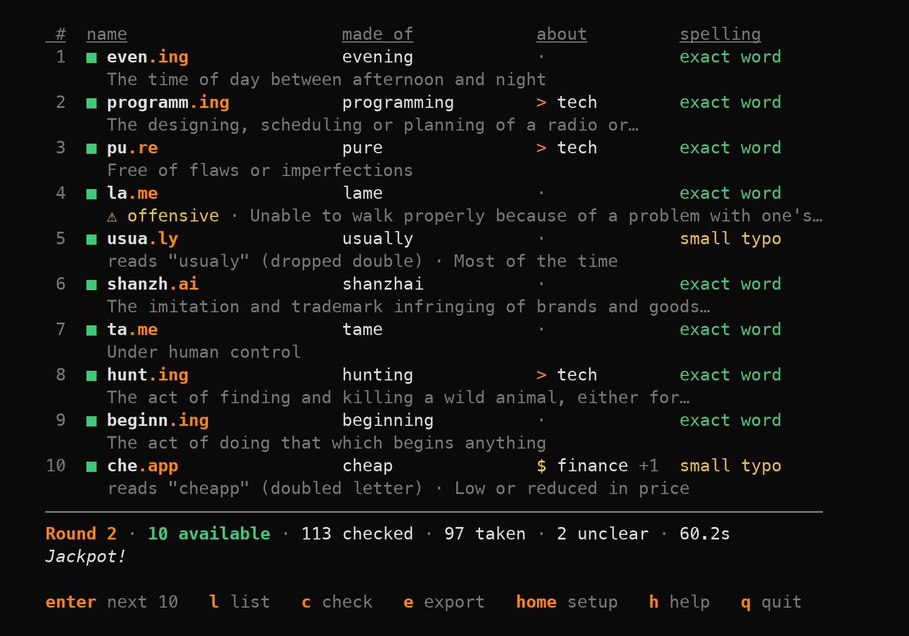
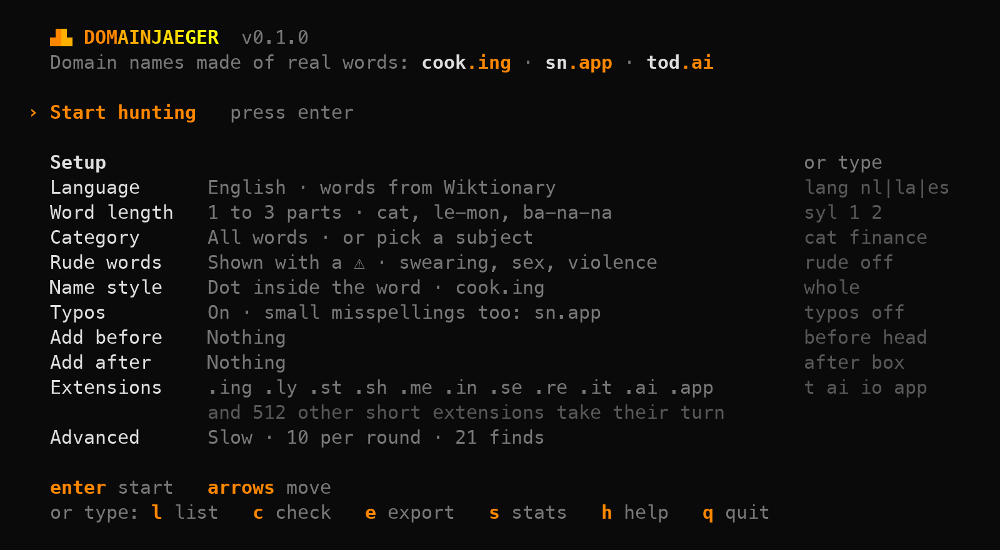
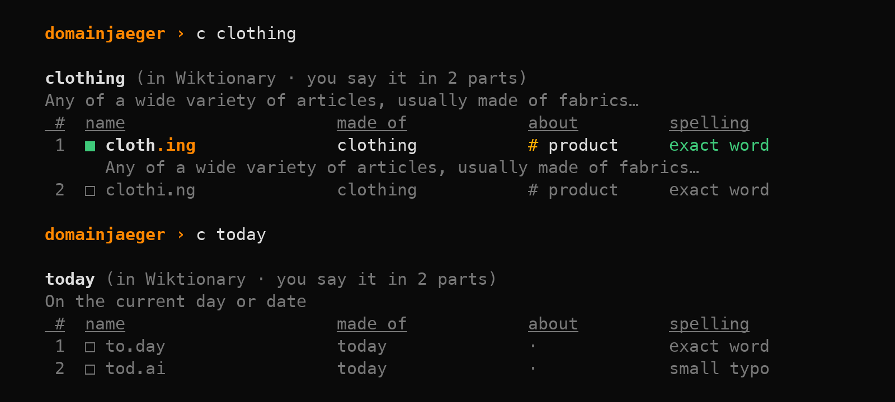

<p align="center">
  
</p>

<p align="center">
  <strong>Domain names made of real words. Verified at the registry before you see them.</strong>
</p>

<p align="center">
  <a href="https://github.com/onehorizonai/domainjaeger/actions/workflows/ci.yml"></a>
  <a href="LICENSE"></a>
  
</p>

# domainjaeger

domainjaeger finds domain names that read as real words. It takes a word from
the dictionary, lets the extension finish it, and asks the registry whether
the name is taken. What you see is a list of names nobody has registered yet.

<p align="center">
  
</p>

```
cooking   → cook.ing       exact
snap      → sn.app         small typo ("snapp")
today     → tod.ai         small typo ("todai")

papegaai  → papega.ai      the same in Dutch
lumen     → lu.men         in Latin
verdad    → verd.ad        in Spanish
Lucas     → luc.as         with a first name
```

- **The whole dictionary.** English, Dutch, Latin and Spanish, read live from
  Wiktionary. The best known words come first.
- **Verified, not suggested.** A name is shown as available only when its
  registry says so.
- **Meaning included.** Each find comes with what the word means, and a ⚠ when
  it can also mean something rude.
- **More than one kind of name.** The dot inside the word (`cook.ing`), the
  whole word (`lemon.nl`), a small typo (`sn.app`), a first name (`mike.ai`),
  or a word of your own before or after (`speedbox.com`).
- **It remembers.** Every answer is kept for four weeks, the hunt goes on where
  it stopped, and everything exports to Excel.
- **Nothing to sign up for.** No account, no API key, no tokens.

## Contents

- [Background](#background)
- [Quick start](#quick-start)
- [Using domainjaeger](#using-domainjaeger)
- [Troubleshooting](#troubleshooting)
- [Development and contributing](#development-and-contributing)
- [Disclaimer](#disclaimer)
- [License](#license)
- [Sponsor](#sponsor)

## Background

domainjaeger began in a chat window. Asking ChatGPT for domain name ideas costs
tokens with every attempt. The suggestions repeat themselves. Most of them are
taken, and you find that out one name at a time.

A dictionary has every word there is. A registry knows which names are free.
Neither charges per question. domainjaeger puts the two together on your own
computer, and it does not run out of ideas.

Jäger is German for hunter.

## Quick start

### Install

domainjaeger is tested on macOS (Apple Silicon) only. Linux and Windows builds
come out of CI, but nobody has verified them yet. If you try one, an
[issue](https://github.com/onehorizonai/domainjaeger/issues) telling how it went is
welcome.

**Homebrew** (macOS, Linux)

```sh
brew install onehorizonai/tap/domainjaeger
```

**Shell installer** (macOS, Linux)

```sh
curl --proto '=https' --tlsv1.2 -LsSf https://github.com/onehorizonai/domainjaeger/releases/latest/download/domainjaeger-installer.sh | sh
```

**PowerShell installer** (Windows)

```powershell
powershell -ExecutionPolicy Bypass -c "irm https://github.com/onehorizonai/domainjaeger/releases/latest/download/domainjaeger-installer.ps1 | iex"
```

**Cargo**, if you have Rust. This builds it from source:

```sh
cargo install --git https://github.com/onehorizonai/domainjaeger
```

domainjaeger is not on crates.io yet, so `cargo install domainjaeger` and
`cargo binstall domainjaeger` do not work for now.

**By hand.** Download the archive for your computer from
[Releases](https://github.com/onehorizonai/domainjaeger/releases/latest), unpack it
and put `domainjaeger` somewhere on your `PATH`.

### Your first hunt

```sh
domainjaeger
```

You land on the home screen. Nothing is looked up yet.

<p align="center">
  
</p>

Press Enter on Start. domainjaeger finds ten available names and stops. Press
Enter again for the next ten.

Three commands cover most of what follows:

| type | to |
| --- | --- |
| `l` | list every available name found so far |
| `c snap` | try a word of your own |
| `e` | save everything to Excel |

The first round takes about a minute. To make every round after it much
faster, tell the dictionary who you are: see [Speed](#speed).

## Using domainjaeger

### The home screen

Move with the arrow keys. Press Enter on a setting to open its choices, and
Esc to go back without changing anything. Nothing is looked up until you press
Enter on Start.

Next to every setting is the command that does the same. You can type a
command at any time. Advanced, the last line, holds what you seldom change:
the speed, the number of names per round, and your finds.

The screen uses plain words. An *extension* is what comes after the dot, also
known as a TLD. A *part* is a syllable: ba-na-na has three. A name with the
*dot inside the word* is what others call a domain hack.

### Commands

| type | to |
| --- | --- |
| `enter` or `n` | start, and after that find the next 10 available names |
| `c snap` | try a word of your own |
| `l` | list the available names found so far, or some of them: `l finance`, `l en`, `l .nl` |
| `e` | save everything checked so far to Excel |
| `s` | show how many names were checked and found |
| `r` | verify names again that were checked more than 4 weeks ago |
| `v` | also show taken names as they are checked |
| `home` | go back to the home screen |
| `h` | show every command |
| `q` | quit |

Here `c` tries two words. For clothing, cloth.ing shows as available and
clothi.ng as taken. For today, both names show as taken.

<p align="center">
  
</p>

An available name gets a green ■ and a taken one a hollow □. An unclear answer
gets a ▒ and is tried again later.

### Settings

Every setting works three ways: a line on the home screen, a command you
type, and a flag when you start.

| setting | what you choose | type | or start with |
| --- | --- | --- | --- |
| Language | English, Dutch, Latin or Spanish words | `lang nl` | `--lang nl` |
| Word length | how many parts a word may have: cat 1, le-mon 2, ba-na-na 3 | `syl 1 2` | `--syllables 1,2` |
| Category | all words, or only those about one subject | `cat finance` | `--category finance` |
| Rude words | vulgar, offensive, sexual and violent words: shown with a ⚠, or left out | `rude off` | `--no-rude` |
| Name style | the dot inside the word (cook.ing), or the whole word before it (lemon.nl) | `w` | `--whole` |
| Typos | every small misspelling (sn.app), one kind of them, or exact words only | `typos off`, `typos missing` | `--typos off` |
| Add before, Add after | a word of your own around every word: headspeed, speedbox | `before head`, `after box` | `--prefix head`, `--suffix box` |
| Extensions | the extensions to hunt in | `t ai io app` | `--tlds ai,io,app` |
| Per round | how many names to find before it stops | `count 20` | `--count 20` |
| Speed | 20 times faster once the dictionary knows who you are | `contact you@example.com` | `--contact you@example.com` |

**Language.** Words come live from [Wiktionary](https://en.wiktionary.org),
and Dutch ones from [WikiWoordenboek](https://nl.wiktionary.org). There is no
word list in this repository. Every available name comes with what its word
means, in English for all four languages.

**Category.** Four are built in, each with a sign of its own: `$` finance, `>`
tech, `#` product and `@` names. Any topic the dictionary has works as well:
`cat music`. Capitals do not matter, and neither does a last s: `cat animal`
finds Animals. `cat list` shows them all, and `cat off` goes back to the whole
dictionary. `cat names` hunts among first names: luc.as, or mike.ai with whole
words on.

**Name style.** The whole word before the dot is for extensions no word ends
in, like `.nl` and `.com`: lemon.nl, or lemmon.nl with a small typo. It hunts
in `.nl` unless you name other extensions: `w com nl`. `w off` puts the dot
back inside the word.

**Typos.** A typo is one small step from the real spelling: a doubled letter
(sn.app), a dropped double (especia.ly), a sound-alike (tod.ai), two swapped
letters (delicio.su) or a missing letter (nmbe.rs). You get all of them, none,
or one kind: `typos missing`. The kinds are `doubled`, `dropped`, `sound`,
`swapped` and `missing`.

**Add before, Add after.** `after box` makes speedbox, `before head` makes
headspeed. These are whole names, so setting one switches the name style.
`after off` takes the word away again.

**Extensions.** Every public extension of 2 to 4 letters takes its turn. The
ones many words end in come by in every cycle. For English those are
`.ing .ly .st .sh .me .in .se .re .it .ai .app`. `t ai io app` hunts only in
the ones you name, and `t all` goes back to all of them.

### How availability is checked

A name is shown as available only when its registry says so.

1. **DNS.** A domain with name servers is registered. This settles most taken
   names without asking a registry.
2. **RDAP at the registry.** "No such registration" means available.
3. **WHOIS at the registry**, for extensions without RDAP, like `.be`, `.de`
   and `.co`.

A registry has to prove itself first: it must call a known registered domain
taken and a gibberish one available. An extension that fails is skipped.

### Speed

Tell the dictionary who you are, and it answers 20 times as fast. Wikimedia
allows 200 requests a minute to clients that give contact details, and 10 to
anonymous ones.

Open Advanced and choose Speed, or type `contact you@example.com`. An e-mail
address or a URL will do. It is stored in the cache on your computer and sent
to Wikimedia only. `contact none` makes you anonymous again.

Anonymous mode works. The first round takes a minute or so.

### Your finds

Every answer is kept in `~/.domainjaeger/cache.sqlite` for 4 weeks. A name is
not looked up twice in that time, and a new session goes on where the last one
stopped.

- `l` lists the available names.
- `e` saves everything checked to `domainjaeger-<date>.xlsx`, or to the file
  you name. It has two sheets, `Available` and `All checked`.
- `r` verifies names again after 4 weeks.
- `reset` starts the dictionary from the first page again. Your finds stay.
- `--db path/to/cache.sqlite` keeps the cache somewhere else.

### Without the home screen

Every setting is a flag, and a hunt can run from start to finish by itself.

```sh
domainjaeger --lang nl --category finance           # start with Dutch words about money
domainjaeger --suffix box --tlds com,nl             # speedbox.com
domainjaeger hunt --rounds 5 --export names.xlsx    # 5 rounds, then write Excel
domainjaeger check snap today                       # your own words
domainjaeger export                                 # Excel from the cache
domainjaeger refresh                                # verify old names again
domainjaeger stats
```

`domainjaeger --help` lists every flag.

### Good to know

- **"Available" means: not registered at the registry.** A registrar may still
  refuse the name or charge a premium for it. Check with a registrar before
  you celebrate.
- **English names are picked over.** In test runs roughly 6 of every 7
  well-known English words were taken. Short ones that do show up as
  available (spr.ing, jo.in) may well be reserved or premium-priced by the
  registry. Treat them as leads.
- **A ⚠ means "look twice", not "this word is rude".** A word is flagged when
  one of its senses is: `cock` is a rooster too. And no flag is no guarantee.
  Volunteers label what they get to.

For the detail, see [AGENTS.md](AGENTS.md), the page for AI agents: where the
words come from, the rules for typos, and the limits of each dictionary and
registry.

## Troubleshooting

**A round takes a minute or more.**
The dictionary does not know you, so it answers 10 questions a minute instead
of 200. Type `contact you@example.com`. See [Speed](#speed).

**I picked `.com` or `.nl` and the name style changed.**
Hardly any word ends in "com" or "nl". When a hunt runs out of words for the
extensions you picked, domainjaeger says so and carries on with the whole word
before the dot: `lemon.nl`. `w off` puts the dot back inside the word. In
`.com` nearly every word is taken. A word of your own opens it up: `after box`
looks for `lemonbox.com`.

**An extension never shows a free name.**
Some registries do not answer public lookups: `.es`, `.as`, `.al` and `.na`.
`.do` gives unclear answers. domainjaeger never shows a name as available when
it cannot verify it, so these extensions are skipped. Check such a name at a
registrar.

**Every name looks taken.**
For well-known English words and for whole words in `.nl`, most names are.
Type `v` to watch what is checked. Then widen the hunt: allow longer words
(`syl 2 3`), pick a category (`cat product`), try another language, or name
other extensions (`t ai io app`).

**Names show a ▒.**
The registry gave no clear answer, usually because it was asked too often.
The name is tried again later. `r` verifies old and unclear names again. When
no registry answered clearly, press enter to ask again.

**The menu does not appear, or the arrow keys do nothing.**
The window is too small, or the input is not a terminal. domainjaeger then
shows the setup once and reads commands line by line. Make the window at least
80 columns by 24 lines and start it again. Every command works either way.

**macOS will not open the downloaded binary.**
The binaries are not signed with an Apple Developer ID, so Gatekeeper holds
back a copy you downloaded in a browser. Install with Homebrew, the shell
installer or Cargo to avoid that. Or allow the copy you have: open System
Settings, go to Privacy & Security and choose Open Anyway, or run

```sh
xattr -d com.apple.quarantine /path/to/domainjaeger
```

**`domainjaeger: command not found` after installing.**
Open a new terminal window. If that does not help, add the folder the
installer printed to your `PATH`. For Cargo that is `~/.cargo/bin`.

**I want to see my finds, move them, or start over.**
See [Your finds](#your-finds). To start with nothing, export first, then
delete `~/.domainjaeger/cache.sqlite`.

**A category runs dry.**
A category is as large as the dictionary made it, and Latin and Spanish ones
are small. `cat list` shows what a language has. `cat off` goes back to the
whole dictionary.

**Something is off on Linux or Windows.**
Those builds are untested.
[Open an issue](https://github.com/onehorizonai/domainjaeger/issues) with what you
saw. It is the fastest way to get them verified.

## Development and contributing

domainjaeger is written in Rust. You need the current stable toolchain.

```sh
git clone https://github.com/onehorizonai/domainjaeger
cd domainjaeger
cargo run --release      # the app
cargo test               # the tests, which run offline
```

Contributions are welcome: bug reports, a verified run on Linux or Windows, a
new language, a better typo rule.

- [CONTRIBUTING.md](CONTRIBUTING.md) explains how the code is laid out, how to
  test without touching your own cache, and what a pull request should look
  like.
- [AGENTS.md](AGENTS.md) holds the rules and the reference for AI agents that
  work on the code or run domainjaeger for you.
- [CHANGELOG.md](CHANGELOG.md) lists the changes.
- [SECURITY.md](SECURITY.md) tells how to report a vulnerability.

By taking part you agree to the [Code of Conduct](CODE_OF_CONDUCT.md).

## Disclaimer

domainjaeger reports what a registry answered at the moment it asked.
"Available" means: not registered at the registry at that time. A name can
still be reserved, priced as premium, bound to residency rules, or registered
a minute later. Check with a registrar before you buy.

You are responsible for the names you register and for how you use them,
including any trademark they may touch. A ⚠ or its absence is a hint from
volunteers' labels, not a judgement on a word.

domainjaeger is an independent project. It is not affiliated with or endorsed
by the Wikimedia Foundation, any registry or registrar, or any AI vendor.
Product names belong to their owners.

Words, topics and definitions come from Wiktionary and WikiWoordenboek. Their
text is available under the
[Creative Commons Attribution-ShareAlike License](https://creativecommons.org/licenses/by-sa/4.0/).

domainjaeger is tested on macOS (Apple Silicon) only. Linux and Windows builds
come out of CI, but nobody has verified them yet.

The software is provided "as is", without warranty of any kind. See the
[license](LICENSE).

## License

[MIT](LICENSE). Copyright (c) 2026 Gijs van de Nieuwegiessen.

## Sponsor

domainjaeger is sponsored by [One Horizon](https://onehorizon.ai). Their
support keeps this project maintained and free for everyone to use.

<p align="center">
  <a href="https://onehorizon.ai"><strong>onehorizon.ai</strong></a>
</p>
