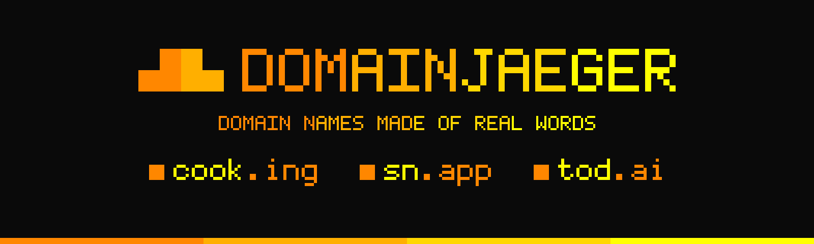

<p align="center">
  
</p>

<p align="center">
  <strong>Domain names made of real words. Verified at the registry before you see them.</strong>
</p>

<p align="center">
  <a href="https://github.com/onehorizonai/domainjaeger/actions/workflows/ci.yml"></a>
  <a href="LICENSE"></a>
  
</p>

# domainjaeger

domainjaeger finds domain names that read as real words. It takes a word from
the dictionary, lets the extension finish it, and asks the registry whether
the name is free. What reaches your screen is a list of names you can still
register.

```
cooking   → cook.ing       exact
snap      → sn.app         small typo ("snapp")
today     → tod.ai         small typo ("todai")

papegaai  → papega.ai      the same in Dutch
lumen     → lu.men         in Latin
verdad    → verd.ad        in Spanish
Lucas     → luc.as         with a first name
```

- **The whole dictionary.** English, Dutch, Latin and Spanish, read live from
  Wiktionary. Every word gets its turn, best known first.
- **Verified, not suggested.** A name is shown as available only when its
  registry says so.
- **Meaning included.** Each find comes with what the word means, and a ⚠ when
  it can also mean something rude.
- **More than one kind of name.** The dot inside the word (`cook.ing`), the
  whole word (`lemon.nl`), a small typo (`sn.app`), a first name (`mike.ai`),
  or a word of your own before or after (`speedbox.com`).
- **It remembers.** Every answer is kept for four weeks, the hunt goes on where
  it stopped, and everything exports to Excel.
- **Nothing to sign up for.** No account, no API key, no tokens.

A round looks like this:

```
   #  name                     made of            about         spelling
   1  ■ cook.ing               cooking            ·             exact word
        The process of preparing food by using heat
   2  ■ ma.in                  main               ·             exact word
        Of chief or leading importance
   3  ■ especia.ly             especially         ·             small typo
        reads "especialy" (dropped double)
   …
  ────────────────────────────────────────────────────────────────────────────
  Round 1 · 9 available · 61 checked · 52 taken · 50.1s
```

> **Tested on macOS (Apple Silicon) only.** Linux and Windows builds come out
> of CI, but nobody has verified them yet.

## Contents

- [Background](#background)
- [Quick start](#quick-start)
- [Using domainjaeger](#using-domainjaeger)
- [Troubleshooting](#troubleshooting)
- [Development and contributing](#development-and-contributing)
- [Disclaimer](#disclaimer)
- [License](#license)
- [Sponsor](#sponsor)

## Background

domainjaeger began in a chat window. Asking ChatGPT for domain name ideas costs
tokens with every attempt. The suggestions repeat themselves. Most of them are
taken, and you find that out one name at a time.

The two things you need already exist, and neither charges per question. A
dictionary has every word there is. A registry knows which names are free.
domainjaeger puts them together: it walks the dictionary, tries every
extension on every word, and checks each candidate where it counts. It runs
on your own computer and it does not run out of ideas.

Jäger is German for hunter.

## Quick start

### Install

domainjaeger is tested on macOS (Apple Silicon) only. Linux and Windows builds
come out of CI, but nobody has verified them yet. If you try one, an
[issue](https://github.com/onehorizonai/domainjaeger/issues) telling how it went is
welcome.

**Homebrew** (macOS, Linux)

```sh
brew install onehorizonai/tap/domainjaeger
```

**Shell installer** (macOS, Linux)

```sh
curl --proto '=https' --tlsv1.2 -LsSf https://github.com/onehorizonai/domainjaeger/releases/latest/download/domainjaeger-installer.sh | sh
```

**PowerShell installer** (Windows)

```powershell
powershell -ExecutionPolicy Bypass -c "irm https://github.com/onehorizonai/domainjaeger/releases/latest/download/domainjaeger-installer.ps1 | iex"
```

**Cargo**, if you have Rust. This builds it from source:

```sh
cargo install --git https://github.com/onehorizonai/domainjaeger
```

domainjaeger is not on crates.io yet, so `cargo install domainjaeger` and
`cargo binstall domainjaeger` do not work for now.

**By hand.** Download the archive for your computer from
[Releases](https://github.com/onehorizonai/domainjaeger/releases/latest), unpack it
and put `domainjaeger` somewhere on your `PATH`.

### Your first hunt

```sh
domainjaeger
```

You land on the home screen. Nothing is looked up yet.

```
› Start hunting   press enter

  Setup                                                          or type
  Language      English · words from Wiktionary                  lang nl|la|es
  Word length   1 to 3 parts · cat, le-mon, ba-na-na             syl 1 2
  Category      All words · or pick a subject                    cat finance
  Rude words    Shown with a ⚠ · swearing, sex, violence         rude off
  Name style    Dot inside the word · cook.ing                   whole
  Typos         On · small misspellings too: sn.app              typos off
  Add before    Nothing                                          before head
  Add after     Nothing                                          after box
  Extensions    .ing .ly .st .sh .me .in .se .re .it .ai .app    t ai io app
                and 512 other short extensions take their turn
  Advanced      Fast · 10 per round · 1,229 finds

  enter start   arrows move
  or type: l list   c check   e export   s stats   h help   q quit
```

Press enter on Start. domainjaeger looks for ten available names and stops.
Press enter again for the next ten.

Three commands cover most of what follows:

| type | to |
| --- | --- |
| `l` | list every available name found so far |
| `c snap` | try a word of your own |
| `e` | save everything to Excel |

The first round takes about a minute. To make every round after it much
faster, tell the dictionary who you are: see [Speed](#speed).

## Using domainjaeger

- [The home screen](#the-home-screen)
- [Commands](#commands)
- [Without the shell](#without-the-shell)
- [Languages](#languages)
- [Meanings](#meanings)
- [Categories](#categories)
- [First names](#first-names)
- [Rude words](#rude-words)
- [Name styles](#name-styles)
- [A word of your own](#a-word-of-your-own)
- [Extensions](#extensions)
- [How availability is checked](#how-availability-is-checked)
- [Speed](#speed)
- [The cache](#the-cache)
- [Excel](#excel)
- [Good to know](#good-to-know)

### The home screen

The home screen shows Start on top and, under it, how the hunt is set up.
Nothing is looked up until you put the arrow on Start and press enter.

Move with the arrow keys. Enter on a setting opens its list of choices. Pick
one, press enter, and you are back where you were. Esc goes back without
changing anything. Space does the same as enter.

Next to every line is the command that does the same. Typing a command works
at any time.

A list, here the one of Category. The dot shows what is in force.

```
  Category
› ● All words          the whole dictionary
  ○ finance            money, markets and bookkeeping
  ○ tech               computers, electronics and engineering
  ○ product            things people make, sell and use
  ○ names              first names, like Mike, Emma and Lucas
  ○ Another subject…   any subject the dictionary has, like music

  enter choose   arrows move   esc back
```

What is seldom touched is a step away, behind the last line.

```
  Advanced                                                       or type
› Speed         Fast · the dictionary knows who you are          contact
  Per round     Finds 10 available names, then stops             count 20
  Your finds    1,229 available names · 2,150 checked            l

  enter change this   arrows move   esc back
  or type: l list   c check   e export   s stats   h help   q quit
```

Everything on these screens starts at the same left edge, and a screen is
drawn over the one before it, so nothing jumps or blinks while you move.

In a list of results, a name that is available gets a green ■ and a taken one
a hollow □. An answer that was unclear gets a ▒ and is tried again later.
Each category has a sign in a colour of its own: `$` finance, `>` tech,
`#` product, `@` names.

The screen speaks plain words. This README uses the proper ones here and
there:

| on screen | also known as |
| --- | --- |
| extension | TLD: what comes after the dot |
| part | syllable: ba-na-na has three |
| dot inside the word | domain hack |

When the input is not a terminal (a script, a pipe), or the window is too
small to draw in, the same screen is shown once and commands are read line by
line.

### Commands

| type | to |
| --- | --- |
| `enter` / `n` | start, and after that: find the next 10 available names |
| `↑` `↓` `enter` | on the home screen: move, and open what the arrow is on (Start, or a setting's list of choices) |
| `home` | go back to the home screen |
| `lang en` / `nl` / `la` / `es` | hunt among English, Dutch, Latin or Spanish words |
| `syl 1 2` | set the word length: only words you say in 1 or 2 parts (cat, le-mon) |
| `cat` | show the categories |
| `cat finance` / `cat finance tech` | hunt only among the words of a category, or of several |
| `cat music` / `cat list` | use any topic of the dictionary; `cat list` shows all of them |
| `cat names` | hunt among first names (luc.as); with `w ai nl`, whole names like mike.ai and mikke.nl |
| `cat off` | go back to the whole dictionary |
| `rude off` / `rude on` | skip words the dictionary flags as vulgar, offensive, sexual or violent, or show them with a ⚠ |
| `w` / `w nl be` / `w off` | hunt for whole words and their typos (lemon.nl) in `.nl` or the extensions you name; `off` puts the dot back inside the word |
| `typos off` / `typos on` | leave small typos out, or let them in |
| `before head` / `after box` / `after off` | put a word of your own before or after every word: headspeed, speedbox |
| `t ai io app` / `t all` | change the extensions |
| `count 20` | find 20 names per round |
| `contact you@example.com` | tell the dictionary who you are: 20 times faster (see [Speed](#speed)) |
| `c <word>` | try a word of your own, for example `c snap` |
| `l` / `l finance` / `l en` / `l .nl` | list the available names found so far, or those of one category, language or extension |
| `e [file.xlsx]` | export everything checked so far to Excel |
| `s` | show how many names were checked and found |
| `r` | verify names again that were checked more than 4 weeks ago |
| `v` | also show taken names as they are checked |
| `reset` | start the dictionary from the first page again |
| `h` | show every command, grouped |
| `q` | quit |

### Without the shell

Every setting is a flag as well, and a hunt can run without the home screen.

```sh
domainjaeger --tlds ai,io,app                       # only the extensions you care about
domainjaeger --category finance                     # only words about money
domainjaeger --lang nl                              # Dutch words instead of English
domainjaeger --lang la                              # Latin, or --lang es for Spanish
domainjaeger --whole                                # whole words and typos in .nl
domainjaeger --category names --whole --tlds ai,nl  # mike.ai, mikke.nl
domainjaeger --suffix box --tlds com,nl             # speedbox.com
domainjaeger --no-rude                              # skip vulgar, sexual and violent words
```

```sh
domainjaeger hunt --rounds 5 --export names.xlsx    # 5 rounds, then write Excel
domainjaeger --category tech hunt --rounds 3        # 3 rounds of tech words
domainjaeger --lang nl --category finance hunt --rounds 3
domainjaeger --lang la hunt --rounds 3              # Latin words
domainjaeger --whole --tlds nl,be hunt --rounds 3   # whole words in .nl and .be
domainjaeger --category names --whole --tlds ai hunt --rounds 3   # first names in .ai
domainjaeger --suffix box --tlds com hunt --rounds 3              # speedbox.com, bluebox.com
domainjaeger check snap today                       # your own words
domainjaeger export [file.xlsx]                     # Excel from the cache
domainjaeger refresh                                # verify expired names again
domainjaeger stats
```

| flag | does |
| --- | --- |
| `--lang nl` | the language: `en`, `nl`, `la` or `es` |
| `--tlds ai,io,app` | the extensions to hunt in |
| `--category finance,tech` | one or more categories |
| `--syllables 1,2` | the word length, in parts |
| `--whole` | the whole word before the dot |
| `--prefix head` / `--suffix box` | a word of your own before or after every word |
| `--no-typos` | exact spellings only |
| `--no-rude` | leave rude words out |
| `--count 20` | names per round |
| `--min-label 3` | the fewest letters allowed before the dot |
| `--contact you@example.com` | who you are, for the dictionary (or set `DOMAINJAEGER_CONTACT`) |
| `--db path/to/cache.sqlite` | another cache (or set `DOMAINJAEGER_DB`) |

`domainjaeger --help` lists them all.

### Languages

Words come live from a dictionary. There is no word list in this repository.

**English** is the default. The words come from the English
[Wiktionary](https://en.wiktionary.org). Its search can match the end of a
title ("every word ending in -ing"), and it returns the best known words
first. It has syllable counts for about 79,000 English words; only words of
1, 2 and 3 syllables are kept. It does not know how many people know a word,
so that column stays empty.

**Dutch** (`--lang nl`) comes from
[WikiWoordenboek](https://nl.wiktionary.org). It keeps a *retrograde* index:
all Dutch words sorted by their reversed spelling. That makes "every word
ending in -ai" one request. The same request returns the syllable count, how
many Dutch speakers know the word, and whether it is in the official
Woordenlijst Nederlandse Taal.

**Latin** (`--lang la`) and **Spanish** (`--lang es`) come from the English
Wiktionary as well. It describes the words of every language, with syllable
counts for about 34,000 Latin and 53,000 Spanish words of up to 3 syllables.
Of those two languages only the form a dictionary lists a word under is used
(amo, not amas and amat; libro, not libros), and only words that are plain
a to z: canción and año cannot be part of a domain name. That leaves about
13,000 Latin and 24,000 Spanish words.

Everything else works the same in all four: typos, categories, the cache and
Excel. Each language keeps its own place in its dictionary.

### Meanings

Every available name comes with what its word means. Meanings come from the
English Wiktionary for all four languages, so they are in English: `lening`
is "a loan, credit" and `lumen` is "light".

You get the first sense of the word, cut down to a few words, on a second
line and in the Excel file. It takes one dictionary request per word, which
is why taken names do not get one.

### Categories

Both dictionaries file their words under topics. A category is a few of those
topics under one name.

| category | Wiktionary topics (English, Latin, Spanish) | WikiWoordenboek topics (Dutch) |
| --- | --- | --- |
| `$` `finance` | Finance, Banking, Accounting, Money, Currencies, Economics, Taxation, Insurance | Financieel, Economie, Boekhouding, Valutanaam |
| `>` `tech` | Computing, Internet, Programming, Electronics, Engineering, Software, Telecommunications, Technology | Informatica, Techniek, Elektronica, Elektrotechniek, Telecommunicatie, Internettaal |
| `#` `product` | Business, Marketing, Manufacturing, Tools, Containers, Clothing, Furniture, Toys | Handel, Industrie, Gereedschap, Huishouden, Kleding, Meubel, Speelgoed |
| `@` `names` | the lists of given names per language | the same lists: Dutch names come from the English Wiktionary |

Any topic is a category of its own: `cat music`, or `cat muziek` and
`cat sport voeding` in Dutch. `cat list` shows every topic a language has.
The built-in ones are one small table in `src/topics.rs`, if you want others.

A hunt in a category turns the search around. It fetches the words of the
topics and tries every extension on each word. Real spellings and near-perfect
typos (sn.app) go first, best known words first. Sound-alikes and swapped
letters come last.

In a hunt without a category, every word is labelled with finance, tech and
product as well, so the Excel file can be filtered on them.

### First names

First names are the category `names`: the given names the English Wiktionary
lists per language, short forms like Mike included. There are about 9,800
English ones, 1,100 Spanish, 700 Latin and 560 Dutch.

A name works like any other word. `cat names` hunts with the dot inside the
name (luc.as, an.na). With whole words on (`w ai nl`) it hunts for the name
itself and its typos (mike.ai, mikke.nl).

The dictionary counted the syllables of few names. A name without a count is
always in. One that is known to be too long is left out.

### Rude words

A word that can mean something rude is marked with a ⚠ and one or more of
four flags. The flags come from how the dictionaries label a word and what
they file it under.

| flag | English Wiktionary (English, Latin, Spanish) | WikiWoordenboek (Dutch) |
| --- | --- | --- |
| vulgar | vulgarities, swear words | Scheldwoord, Vulgair, Krachtterm |
| offensive | offensive terms, ethnic slurs | – |
| sexual | Sex, Genitalia, Prostitution, Pornography | Seksualiteit |
| violent | Violence, Murder | – |

`rude off` (or `--no-rude`) leaves those words out of the hunt altogether.

### Name styles

**Dot inside the word.** The extension finishes the word: `cook.ing`. This is
the default.

**Typos** are one small step away from the real spelling. `typos off` (or
`--no-typos`) keeps to exact words.

| kind | English | Dutch |
| --- | --- | --- |
| doubled letter | snap → sn.app | knap → kn.app |
| dropped double | especially → especia.ly | tobbe → to.be |
| sound-alike (c/k, i/y, s/z) | today → tod.ai | display → displ.ai |
| swapped letters | delicious → delicio.su | strooi → stro.io |

**Whole word before the dot** (`w`, or `--whole`) is the plain alternative
for extensions no word ends in, like `.nl` and `.com`. The name is the word
itself (`lemon.nl`, `lening.nl`) or a small typo of it. domainjaeger switches
to this style by itself when the extensions you picked have no words left
with the dot inside.

The hunt starts with the best known words and works its way down. With a
category it uses the words of that category. Per word it tries the word and
its most natural typo first, and the clumsier typos only after every word had
its turn. The typo rules were written with Dutch spelling in mind:

| kind | example | |
| --- | --- | --- |
| dropped double | appel → apel.nl | natural |
| sound-alike (ij → y, c → k, s/z) | konijn → konyn.nl, circus → cirkus.nl, fiets → fietz.nl | natural |
| doubled consonant between vowels | lening → lenning.nl | natural |
| doubled last letter | knap → knapp.nl | clumsy |
| last letters swapped | lening → lenign.nl | clumsy |

Whole words are hunted in `.nl` unless you name other extensions:
`w com nl`, or `--tlds nl,be,eu`.

### A word of your own

A word of your own can go before or after every word. `after box` (or
`--suffix box`) makes speedbox and bluebox. `before head` (or
`--prefix head`) makes headspeed. Both can be on at once.

These are whole names, so setting one switches the name style to the whole
word before the dot, in `.nl` unless you say otherwise: `w com nl`.

The words come from the same lists as whole words: the best known first, or
those of a category (`cat tech` with `after box`). There are no typos of such
a name.

### Extensions

Extensions come from IANA (all delegated TLDs), minus brand TLDs (ICANN's
list) and TLDs that turn out to be closed. By default only extensions of 2 to
4 letters are used.

A handful get a turn in every cycle: the ones many words end in and whose
registry answers lookups.

| language | always in the mix | |
| --- | --- | --- |
| English | `.ing .ly .st .sh .me .in .se .re .it .ai .app` | cook.ing, sn.app |
| Dutch | `.ai .app .me .je .st .ng .ing .rs .ht .is` | huis.je, kun.st, leni.ng |
| Latin | `.is .io .men .im .la .ma .to .ro .co` | can.is, rat.io, lu.men, inter.im |
| Spanish | `.to .ro .io .la .so .co .ma .re .ad .je` | ga.to, lib.ro, verd.ad, via.je |

`.io`, `.co` and `.be` are nearly sold out for Dutch words, so they only come
by now and then with the other extensions. `t io co be` hunts in them anyway.

The same goes for the two richest word endings of Latin and Spanish. 2,700
Latin words end in -us and 4,000 Spanish verbs in -ar, but `.us` is for people
with a tie to the United States and `.ar` takes an Argentine tax number.
`t us` and `t ar` hunt there if that is you.

### How availability is checked

A name is reported as available only when its registry says so.

1. **DNS.** A domain with name servers is registered. This settles most taken
   names without bothering a registry. The question goes to the public
   resolvers of Google and Cloudflare, over HTTPS.
2. **RDAP at the registry.** "404, no such registration" means available.
3. **WHOIS at the registry**, for extensions without RDAP (`.be`, `.de`,
   `.co`, ...).

Before a registry lookup is trusted for an extension, it is calibrated: it
must call a known registered domain taken and a gibberish one available.
Extensions that fail are skipped.

Registries limit how often you may ask. Google's `.app` and `.dev` and SIDN's
`.nl` allow about one lookup per second. The hunt paces itself and moves on to
other extensions while one is busy. An unclear answer is shown as ▒ and
retried later.

### Speed

Tell the dictionary who you are, and it answers 20 times as fast. Wikimedia
allows 200 requests a minute to clients with contact details in the
User-Agent, and 10 to anonymous ones.

The home screen shows which one you are, under Advanced, as Speed. To
identify yourself, pick Fast there, type `contact you@example.com` (an e-mail
address or a URL), pass `--contact`, or set `DOMAINJAEGER_CONTACT`.
`contact none` makes you anonymous again.

Your contact is stored in the cache on your computer and sent to Wikimedia
only. Without one, domainjaeger identifies itself by its name, its version and
the address of this repository.

Anonymous mode works. The first round just takes a minute or so.

### The cache

`~/.domainjaeger/cache.sqlite` remembers every verdict for 4 weeks (28 days).
Use `--db` or `DOMAINJAEGER_DB` to keep it somewhere else.

Checked names are not looked up again within that time. The position in the
dictionary is saved, so a new session continues where the last one stopped.
After 4 weeks, `r` (or `domainjaeger refresh`) verifies names again. The
words of a category are kept for 4 weeks as well, so a topic is downloaded
once.

`reset` starts the dictionary from the first page again. Your finds stay.

### Excel

`e` (or `domainjaeger export`) writes `domainjaeger-<date>.xlsx`, or the file
you name. It has two sheets, `Available` and `All checked`.

Each row has the word, its meaning, its tone (the ⚠ flags), language,
category, syllables, extension, whether the name has the dot inside the word,
is a whole word or carries a word of your own, the kind of typo, how well
known the word is, its dictionary topics, how the name was verified and until
when the verdict is valid.

An available name that has no meaning yet gets one when you export. That is
one request per word; ctrl-c goes on without the rest.

### Good to know

- **A category is a selection, not a complete list.** Volunteers label the
  words: `bank` has nine topics, `hypotheek` only "Juridisch". Most words have
  no topic at all, so in a hunt without a category most rows have none.
- **How well known a word is** is only known for Dutch, and shown for words
  that at least 76% of the Dutch know. The dictionary request has room for 50
  questions per word, and the lower percentages made way for the topics and
  the rude-word labels.
- **A ⚠ means "look twice", not "this word is rude".** A word is flagged
  when one of its senses is: `cock` is a rooster too. And no flag is no
  guarantee: volunteers label what they get to. Dutch has no labels for
  offensive and violent words, and the flags say nothing about what a name
  sounds like in another language.
- **Meanings cost a dictionary request per available name.** Unnoticeable
  once the dictionary knows you. Anonymous, with 10 requests a minute, a
  round of 10 names takes about a minute longer.
- **Latin and Spanish categories are thin.** Latin has 11 words under Finance
  and 8 under Computing, so `cat finance` or `cat tech` runs dry quickly
  there. Spanish does better (Computing 333, Clothing 244, Finance 101).
  `cat list` shows what a language does have: Latin is strong in law,
  anatomy, plants and mythology.
- **First names come in no order of popularity.** Nobody counts how many
  people carry a name in a dictionary. The names whose page is about little
  else come first (Emma, Hans, Julie), which is a fair stand-in. Other
  sources would do better for one country each (the US social security list,
  the Dutch Voornamenbank, the Spanish INE), but none covers four languages,
  Latin least of all, and none can be asked live.
- **Spain's own `.es` cannot be checked.** Its registry does not answer
  public lookups, and neither do those of `.as`, `.al` and `.na`; `.do` gives
  unclear answers. Names there are never reported as available, so Spanish
  whole words are hunted in `.nl` like the rest unless you name other
  extensions.
- **Latin and Spanish lean on English.** The best known pages come first, and
  those are often words English shares (virus, radio, popular). Typo rules
  were written for Dutch and English spelling.
- **Whole words in `.nl` are nearly all taken**, and so are many of their
  typos (`sien.nl`, `halo.nl`, `lenning.nl`). In test runs about 1 name in 7
  was free, almost all of them typos. Every free name needs an answer from
  SIDN, which allows about one lookup per 1.5 seconds, so a round takes 15 to
  30 seconds.
- **"Best known" is the dictionary's idea of it.** Whole words and names with
  a word of your own in English, Latin and Spanish start with the pages the
  dictionary links to most, minus its own jargon (genitive, plural) and words
  of one or two letters. Everyday words come early (animal, plant, light,
  fire), with some odd ones in between (hanja, esse). A category gives a
  tidier list: `cat product` with `after box`. Or try your own word:
  `c speed` checks speedbox while `after box` is on.
- **English names are picked over.** In test runs roughly 6 of every 7
  well-known English words were taken, and short ones that do show up as
  available (spr.ing, jo.in) may well be reserved or premium-priced by the
  registry. Treat them as leads.
- **"Available" means: not registered at the registry.** A registrar may
  still refuse the name (reserved or premium names, residency rules of a
  country extension) or charge a premium. Check with a registrar before you
  celebrate.

## Troubleshooting

**A round takes a minute or more.**
The dictionary does not know you, so it answers 10 questions a minute instead
of 200. Open Advanced, choose Speed and pick Fast, or type
`contact you@example.com`. See [Speed](#speed).

**I picked `.com` or `.nl` and the name style changed.**
Hardly any word ends in "com" or "nl". With the dot inside the word, such an
extension has next to nothing to offer in any language. When a hunt runs out
of words for the extensions you picked, domainjaeger says so and carries on
with the whole word before the dot: `lemon.nl`. `whole off` puts the dot back
inside the word. In `.com` nearly every word is taken; a word of your own
opens it up: `after box` looks for `lemonbox.com`.

**An extension never shows a free name.**
Some registries do not answer public lookups: `.es`, `.as`, `.al` and `.na`.
`.do` gives unclear answers. domainjaeger never reports a name as available
when it cannot verify it, so these extensions are skipped. Check such a name
at a registrar.

**Every name looks taken.**
For well-known English words and for whole words in `.nl`, most names are
taken. Type `v` to watch what is checked. Then widen the hunt: turn typos on,
allow longer words (`syl 2 3`), pick a category (`cat product`), try another
language, or name other extensions (`t ai io app`).
When domainjaeger says this about a single extension, its registry called
even a gibberish name taken. The lookup cannot be trusted, and the extension
is left out.

**Names show a ▒.**
The registry gave no clear answer, usually because it was asked too often.
The name is tried again later. `r` verifies old and unclear names again.

**The menu does not appear, or the arrow keys do nothing.**
The window is too small to draw the menu in, or the input is not a terminal.
domainjaeger then shows the setup once and reads commands line by line. Make
the window larger (80 columns by 24 lines is enough) and start it again.
Every command works either way.

**macOS will not open the downloaded binary.**
The binaries are not signed with an Apple Developer ID. A copy you downloaded
in a browser is held back by Gatekeeper. Install with Homebrew, the shell
installer or Cargo to avoid that. Or allow the copy you have: open System
Settings, go to Privacy & Security and choose Open Anyway, or run

```sh
xattr -d com.apple.quarantine /path/to/domainjaeger
```

**`domainjaeger: command not found` after installing.**
Open a new terminal window. If that does not help, add the folder the
installer printed to your `PATH`. For Cargo that is `~/.cargo/bin`.

**I want to see my finds, move them, or start over.**
Everything is in `~/.domainjaeger/cache.sqlite`. `l` lists your finds and `e`
saves them to Excel. `--db path/to/cache.sqlite` uses another file, which is
also how you try things without touching your own. `reset` starts the
dictionary from the first page again and keeps your finds. To start with
nothing, export first, then delete the file.

**A category runs dry.**
A category is as large as the dictionary made it, and Latin and Spanish ones
are small. `cat list` shows what a language has. `cat off` goes back to the
whole dictionary.

**Something is off on Linux or Windows.**
Those builds are untested. Please
[open an issue](https://github.com/onehorizonai/domainjaeger/issues) with what you
saw. It is the fastest way to get them verified.

## Development and contributing

domainjaeger is written in Rust. You need the current stable toolchain.

```sh
git clone https://github.com/onehorizonai/domainjaeger
cd domainjaeger
cargo run --release      # the app
cargo test               # the tests, which run offline
```

Contributions are welcome: bug reports, a verified run on Linux or Windows, a
new language, a better typo rule. [CONTRIBUTING.md](CONTRIBUTING.md) explains
how the code is laid out, how to test without touching your own cache, and
what a pull request should look like. By taking part you agree to the
[Code of Conduct](CODE_OF_CONDUCT.md). To report a vulnerability, see
[SECURITY.md](SECURITY.md). Changes are listed in
[CHANGELOG.md](CHANGELOG.md).

## Disclaimer

domainjaeger reports what a registry answered at the moment it asked.
"Available" means: not registered at the registry at that time. A name can
still be reserved, priced as premium, bound to residency rules, or registered
a minute later. Check with a registrar before you buy.

You are responsible for the names you register and for how you use them,
including any trademark they may touch. A ⚠ or its absence is a hint from
volunteers' labels, not a judgement on a word.

domainjaeger is an independent project. It is not affiliated with or endorsed
by the Wikimedia Foundation, any registry or registrar, or any AI vendor.
Product names belong to their owners.

Words, topics and definitions come from Wiktionary and WikiWoordenboek. Their
text is available under the
[Creative Commons Attribution-ShareAlike License](https://creativecommons.org/licenses/by-sa/4.0/).

domainjaeger is tested on macOS (Apple Silicon) only. Linux and Windows builds
come out of CI, but nobody has verified them yet.

The software is provided "as is", without warranty of any kind. See the
[license](LICENSE).

## License

[MIT](LICENSE). Copyright (c) 2026 Gijs van de Nieuwegiessen.

## Sponsor

domainjaeger is sponsored by [One Horizon](https://onehorizon.ai). Their
support keeps this project maintained and free for everyone to use.

<p align="center">
  <a href="https://onehorizon.ai"><strong>onehorizon.ai</strong></a>
</p>
